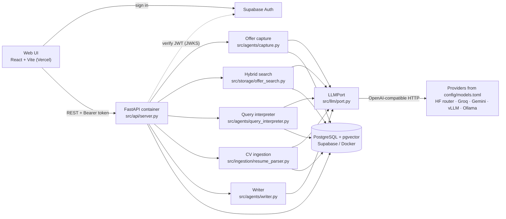

# Career Mate

A personal job-search assistant. Paste a job link (or write an offer by hand) and Career Mate turns it into a structured offer card, files it in your folders, tracks where you are with it, and lets you search everything by meaning or in plain language. Your CV becomes a structured profile the assistant can answer questions about.

It runs locally for one person (no login), or hosted for several people: each user signs in (Supabase Auth) and only ever sees their own offers, CV and contacts.

- **Run it on your machine: [SETUP.md](SETUP.md)** (about 15 minutes).
- **Host it (Supabase + a container + Vercel): [DEPLOYMENT.md](DEPLOYMENT.md).**
- **The concepts behind this stack, from fundamentals up: [CONCEPTS.md](CONCEPTS.md).**

```bash
uv sync --locked && npm --prefix ui install
docker compose up -d db                # PostgreSQL + pgvector on localhost:5432
uv run python -m src.cli init          # creates .env and the database schema
uv run python -m src.cli check --live  # after adding your keys to .env
uv run uvicorn src.api.server:app --reload
npm --prefix ui run dev                # http://localhost:5173
```

---

## What you can do

**Job Explorer**
- **Capture an offer from a link.** 
- **Paste the text** when a site blocks automated reading or **add an offer by hand** with the same fields. Every offer card can be edited.
- **Organize**: folders in the sidebar (create, rename, delete), drag cards onto a folder, statuses from *Saved* to *Accepted / Rejected / Archived*.
- **Three layouts**: Grid, Table, and a Board with one column per status (drag a card to change its status).
- **Search by meaning or keywords**: "apprentissage automatique" finds an English "Machine Learning" offer.
- **Ask in plain language**: "alternance en hybride, deadline avant fin novembre" becomes visible filters (contract, remote, deadline) plus search words.
- **Filters and saved views**: status, contract, remote, deadline, sort; save any combination with its layout.

**Offer sheet**: all extracted fields, the original posting text, your notes, and **people to reach** (name, role, LinkedIn, notes, a "reached out" tick with its date).

**Profile**: upload your CV (PDF or text). The file and the parsed, editable profile are stored with your account in the database.

**AI Generator**: cover letters, emails and interview preparation based on an offer and your profile.

---

## Architecture



### Model layer: one interface, models in config

All model calls go through **LLMPort** (`src/llm/port.py`), a single client for the OpenAI-compatible protocol, which Gemini, the Hugging Face router, Groq, vLLM, llama.cpp and Ollama all speak. App code asks for a **role**, never a model:

| Role | Used for |
|---|---|
| `extract` | reading offers, parsing CVs |
| `write` | letters, emails, interview prep |
| `query` | turning a plain-language search into filters |
| `embed` | embeddings for meaning-based search |

`config/models.toml` is the only place model names live. `[defaults]` switches every role at once (default: `openai/gpt-oss-120b` on Groq through the Hugging Face router); a role can pin its own model (embeddings stay on `gemini-embedding-001`); env vars (`LLM_DEFAULT_MODEL`, `LLM_<ROLE>_MODEL`) override without editing. A new provider is one `[providers.<name>]` block.

LLMPort validates structured output with Pydantic (one repair attempt), retries rate limits using the provider's `Retry-After`, stops at once on a daily quota, supports tool calling, and logs every call (user, model, prompt version, tokens, latency, cost) to the `llm_calls` table.

### Login and data isolation

The web UI signs users in with **Supabase Auth** (email + password) and sends the access token (a JWT) with every API call. The API verifies the token's signature with the project's public keys (JWKS, fetched once and cached), reads the user id from it, and **every query is filtered by that `user_id`**. Row-level security is enabled on every table with no policies, so even if the schema were exposed through Supabase's REST API, it would return nothing. Without `SUPABASE_URL` (local development) there is no login and all requests belong to one fixed dev user; `APP_ENV=production` refuses to start that way.

### Data: PostgreSQL

One PostgreSQL database (Supabase in production, the `pgvector/pgvector` image locally), app tables in a private schema (`DB_SCHEMA`, default `career`). The schema is created by versioned SQL files in `src/storage/migrations/`, applied by `src.cli migrate` (the container runs it on start).

| Table | Holds |
|---|---|
| `offers` | what the employer published: extracted fields, original text, source, model and prompt version; a generated, weighted full-text column `search` |
| `applications` | what you do with it (1:1): status, folder, notes, applied date |
| `folders`, `views`, `contacts` | your organization, saved filters, people to reach |
| `events` | append-only history: captured, edited, moved, status changed, contact reached (with who did it: you, the AI or an automation) |
| `offer_embeddings` | `vector` column (pgvector) for meaning-based search, tagged with the model and a hash of the text |
| `profiles` | parsed CV profile (`jsonb`) and the uploaded file (`bytea`) |
| `llm_calls` | every model call |

Every table has a `user_id`. Fixed value lists (statuses, contract types, remote policies) feed the forms, the filters and validation alike. `ENUM_FILTERS` in `src/storage/db.py` is the single registry of filterable fields: one entry makes a field filterable in SQL, in the API and in plain-language search. Skill spellings are merged when saved (`SKILL_ALIASES`: "postgres" becomes "PostgreSQL").

### Search

**Hybrid search** (`src/storage/offer_search.py`) merges two rankings with Reciprocal Rank Fusion, inside the active filters:
- **keyword**: PostgreSQL full-text search (`tsvector` with title/company weighted highest, prefix matching, accents ignored, ranked by `ts_rank_cd`);
- **meaning**: cosine similarity (pgvector's `<=>`) between your query and each offer's embedding. The embedded text is built from every text field an offer has, so new fields are searchable without code changes.

Embeddings are computed lazily before a search, only for new or edited offers, and recomputed when the embedding model changes; saving an offer never waits for the embedding API. A result counts as related when its similarity is above a floor and close to the query's best match (both in `[roles.embed]` of `config/models.toml`). If embeddings are unavailable, search falls back to keywords and the UI says so.

**Plain-language search** (`src/agents/query_interpreter.py`) builds its response schema at run time from `ENUM_FILTERS`, your folders and the sort options, so the model can only answer with real values. Relative dates ("fin novembre") are resolved from today. The result is applied as ordinary filters you can see and change.

Measured on small labeled FR/EN sets (re-run with the scripts below):

| | recall@3 | precision | MRR |
|---|---|---|---|
| keyword only | 0.45 | 0.60 | 0.60 |
| **hybrid** | **0.90** | **1.00** | **1.00** |

Plain-language search: 9/10 requests fully correct, filter precision 1.00, median 3.4 s.

---

## Repository layout

| Path | Contents |
|---|---|
| `src/api/server.py` | FastAPI endpoints (all scoped to the signed-in user) |
| `src/api/auth.py` | Supabase token verification, dev user |
| `src/agents/` | offer capture, query interpreter, CV parser, writer, analyzer |
| `src/llm/port.py` | LLMPort, the only model client |
| `src/storage/db.py` | connection pool, migrations runner, user-scoped queries, `ENUM_FILTERS`, `SKILL_ALIASES` |
| `src/storage/migrations/` | versioned SQL schema |
| `src/storage/offer_search.py` | hybrid search and offer embeddings |
| `src/ingestion/resume_parser.py` | CV upload, text extraction, parsing |
| `src/cli.py` | `init`, `migrate`, `check`, `reindex`, `import-sqlite` |
| `src/prompts/` | prompt files |
| `config/models.toml` | providers, roles, default model, search thresholds |
| `ui/src/app/` | React app (`api.ts`: API address, Supabase client, `apiFetch` adds the token) |
| `Dockerfile`, `docker-compose.yml` | API image; local Postgres (+ API) stack |
| `scripts/` | `measure_search.py`, `measure_query.py` |
| `docs/` | earlier design notes (may describe the previous architecture) |

---

## Checks and measurements

The self-checks need a reachable PostgreSQL (`DATABASE_URL`); each works in a throwaway schema it drops afterwards.

```bash
uv run python -m src.storage.db                 # queries, filters, search, views, user isolation
uv run python -m src.storage.offer_search       # hybrid search, embeddings, fallback
uv run python -m src.agents.query_interpreter   # plain-language search plan
uv run python -m src.llm.port                   # model layer: retries, structured output, config
uv run python -m src.api.auth                   # token verification (signature, expiry, audience, issuer)
uv run python -m src.ingestion.resume_parser    # upload validation, profile storage
uv run python -m src.cli selftest               # init, import from the old SQLite format
uv run python -m src.cli check --live           # your configuration, with one call per model
uv run python scripts/measure_search.py         # search quality on real embeddings
uv run python scripts/measure_query.py          # plain-language search accuracy
```

---

## Privacy

- Each user's data is separated by `user_id` in every query, with row-level security as a safety net. Whoever hosts the instance (the database owner) can read everything: host it only for people who trust you.
- Contacts are other people's personal data; CVs are yours. Both live in the database, not in the repository.
- `.env` holds secrets and is git-ignored; in production, secrets are set on the host, never in the image or the repo.
- Text you capture or upload is sent to the configured model providers; free tiers may log prompts. Point the roles at a local model (`vllm` or `local` provider) to keep everything on your machine.

---

## Roadmap

- CI/CD with GitHub Actions: tests against a Postgres service container, image build, deploy on merge.
- Skill graph between your profile and your offers: "best for me" ranking, similar offers, skill gaps.
- Activity timeline per offer, next action with a due date and reminders.
- Multi-value filters ("CDD or internship").
