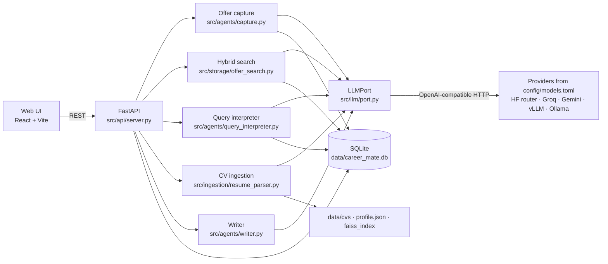

# Career Mate

A personal job-search assistant you run on your own machine. Paste a job link (or write an offer by hand) and Career Mate turns it into a structured offer card, files it in your folders, tracks where you are with it, and lets you search everything by meaning or in plain language. Your CV becomes a structured profile the assistant can answer questions about.

Each person runs a **private copy**: own database, CV, offers, contacts and API keys. Nothing is shared and there is no account to create.

**Set up your own copy: [SETUP.md](SETUP.md)** (about 15 minutes).

```bash
uv sync --locked && npm --prefix ui install
uv run python -m src.cli init          # creates .env, the data folder and the database
uv run python -m src.cli check --live  # after adding your keys to .env
uv run uvicorn src.api.server:app --reload
npm --prefix ui run dev                # http://localhost:5173
```

---

## What you can do

**Job Explorer**
- **Capture an offer from a link.** 
- **Paste the text** when a site blocks automated reading or **add an offer by hand** with the same fields. Every offer card can be edited.
- **Organize**: folders in the sidebar (create, rename, delete), drag cards onto a folder, statuses from *Saved* to *Accepted / Rejected / Archived*.
- **Three layouts**: Grid, Table, and a Board with one column per status (drag a card to change its status).
- **Search by meaning or keywords**: "apprentissage automatique" finds an English "Machine Learning" offer.
- **Ask in plain language**: "alternance en hybride, deadline avant fin novembre" becomes visible filters (contract, remote, deadline) plus search words.
- **Filters and saved views**: status, contract, remote, deadline, sort; save any combination with its layout.

**Offer sheet**: all extracted fields, the original posting text, your notes, and **people to reach** (name, role, LinkedIn, notes, a "reached out" tick with its date).

**Profile**: upload your CV (PDF or text). It is saved in your data folder, parsed into a structured, editable profile, and indexed so you can ask questions about it. The profile is restored at startup without calling a model.

**AI Generator**: cover letters, emails and interview preparation based on an offer and your profile.

---

## Architecture



### Model layer: one interface, models in config

All model calls go through **LLMPort** (`src/llm/port.py`), a single client for the OpenAI-compatible protocol, which Gemini, the Hugging Face router, Groq, vLLM, llama.cpp and Ollama all speak. App code asks for a **role**, never a model:

| Role | Used for |
|---|---|
| `extract` | reading offers, parsing CVs |
| `write` | letters, emails, interview prep |
| `query` | turning a plain-language search into filters |
| `route`, `chat` | the chat graph (routing, CV questions) |
| `judge` | `evaluate.py` |
| `embed` | embeddings for meaning-based search and CV search |

`config/models.toml` is the only place model names live. `[defaults]` switches every role at once (default: `openai/gpt-oss-120b` on Groq through the Hugging Face router); a role can pin its own model (embeddings stay on `gemini-embedding-001`); env vars (`LLM_DEFAULT_MODEL`, `LLM_<ROLE>_MODEL`) override without editing. A new provider is one `[providers.<name>]` block.

LLMPort validates structured output with Pydantic (one repair attempt), retries rate limits using the provider's `Retry-After`, stops at once on a daily quota, supports tool calling, and logs every call (model, prompt version, tokens, latency, cost) to the `llm_calls` table.

### Data: one SQLite file per person

| Table | Holds |
|---|---|
| `offers` | what the employer published: extracted fields, original text, source, model and prompt version that extracted it |
| `applications` | what you do with it (1:1): status, folder, notes, applied date |
| `folders`, `views`, `contacts` | your organization, saved filters, people to reach |
| `events` | append-only history: captured, edited, moved, status changed, contact reached (with who did it: you, the AI or an automation) |
| `offers_fts` | full-text index (SQLite FTS5), kept in sync by triggers |
| `offer_embeddings` | vectors for meaning-based search, tagged with the model and a hash of the text |
| `llm_calls` | every model call |

Fixed value lists (statuses, contract types, remote policies) feed the forms, the filters and validation alike. `ENUM_FILTERS` in `src/storage/db.py` is the single registry of filterable fields: one entry makes a field filterable in SQL, in the API and in plain-language search. Skill spellings are merged when saved (`SKILL_ALIASES`: "postgres" becomes "PostgreSQL"). Existing databases are upgraded in place by `init`.

### Search

**Hybrid search** (`src/storage/offer_search.py`) merges two rankings with Reciprocal Rank Fusion, inside the active filters:
- **keyword**: BM25 over the FTS5 index (prefix matching, accents ignored);
- **meaning**: cosine similarity between your query and each offer's embedding. The embedded text is built from every text field an offer has, so new fields are searchable without code changes.

Embeddings are computed lazily before a search, only for new or edited offers, and recomputed when the embedding model changes; saving an offer never waits for the embedding API. A result counts as related when its similarity is above a floor and close to the query's best match (both in `[roles.embed]` of `config/models.toml`). If embeddings are unavailable, search falls back to keywords and the UI says so.

**Plain-language search** (`src/agents/query_interpreter.py`) builds its response schema at run time from `ENUM_FILTERS`, your folders and the sort options, so the model can only answer with real values. Relative dates ("fin novembre") are resolved from today. The result is applied as ordinary filters you can see and change.

Measured on small labeled FR/EN sets (re-run with the scripts below):

| | recall@3 | precision | MRR |
|---|---|---|---|
| keyword only | 0.45 | 0.60 | 0.60 |
| **hybrid** | **0.90** | **1.00** | **1.00** |

Plain-language search: 9/10 requests fully correct, filter precision 1.00, median 3.4 s.

### CV and profile

Upload → text extraction (pypdf) → structured profile (`extract` role) → saved to `data/profile.json` and indexed in a FAISS index (`data/faiss_index`, tagged with its embedding model). At startup the saved profile is reloaded; the index is rebuilt only if it is missing or was built with another embedding model.

### Chat graph (backend only)

The LangGraph chat (`src/graph/`: router, CV questions, general chat, legacy web-search pipeline via Google Custom Search) is still served at `/api/chat` and `/api/chat/stream`, but the web UI no longer has a chat page.

---

## Repository layout

| Path | Contents |
|---|---|
| `src/api/server.py` | FastAPI endpoints |
| `src/agents/` | offer capture, query interpreter, CV parser, writer, analyzer, legacy collector/matcher |
| `src/llm/port.py` | LLMPort, the only model client |
| `src/storage/db.py` | SQLite schema, migrations, queries, `ENUM_FILTERS`, `SKILL_ALIASES` |
| `src/storage/offer_search.py` | hybrid search and offer embeddings |
| `src/ingestion/resume_parser.py` | CV upload, profile persistence |
| `src/cli.py` | `init`, `check`, `reindex` |
| `src/prompts/` | prompt files |
| `config/models.toml` | providers, roles, default model, search thresholds |
| `ui/src/app/` | React app (`api.ts` reads `VITE_API_URL`) |
| `scripts/` | `measure_search.py`, `measure_query.py` |
| `docs/` | earlier design notes (may describe the previous architecture) |

---

## Checks and measurements

```bash
uv run python -m src.storage.db                 # schema, migrations, filters, search, views
uv run python -m src.storage.offer_search       # hybrid search, embeddings, fallback
uv run python -m src.agents.query_interpreter   # plain-language search plan
uv run python -m src.llm.port                   # model layer: retries, structured output, config
uv run python -m src.cli check --live           # your configuration, with one call per model
uv run python scripts/measure_search.py         # search quality on real embeddings
uv run python scripts/measure_query.py          # plain-language search accuracy
```

---

## Privacy

- Everything personal lives in your data folder (`DATA_DIR`) and `.env`, both git-ignored. Back up by copying the folder.
- The API has no login and listens only on `127.0.0.1`; don't expose it on a shared network.
- Text you capture or upload is sent to the configured model providers; free tiers may log prompts. Point the roles at a local model (`vllm` or `local` provider) to keep everything on your machine.

---

## Roadmap

- Skill graph between your profile and your offers: "best for me" ranking, similar offers, skill gaps.
- Activity timeline per offer, logged activities, next action with a due date and reminders.
- Multi-value filters ("CDD or internship").
- Optional PostgreSQL backend for a hosted, multi-user deployment.
