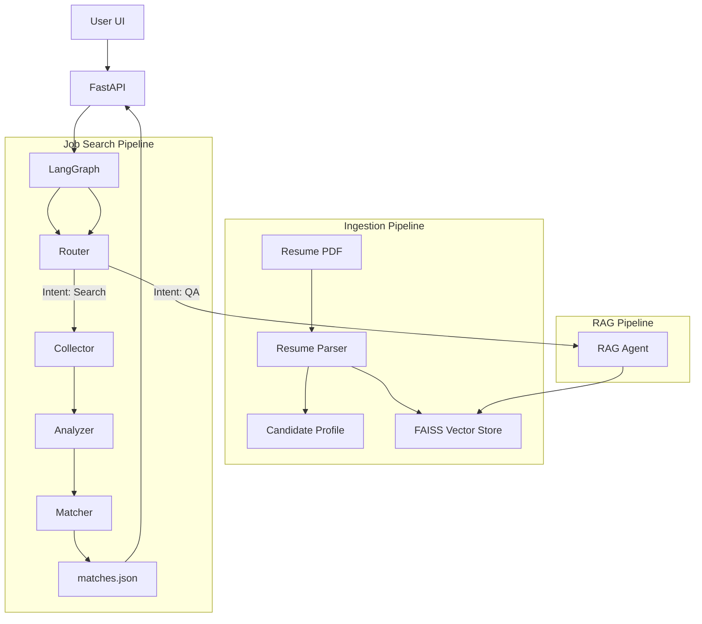

# Career Mate / RecruitAI - System Architecture

## Overview
RecruitAI is an Agentic AI system designed to automate the job search lifecycle. It leverages a Multi-Agent architecture orchestrated by LangGraph, with a React Frontend and FastAPI Backend.

## Core Components

### 1. Frontend (React + TypeScript)
- **ProfileView**: Reactive form bound to the active candidate profile. Handles PDF upload via `/api/upload_resume`.
- **JobExplorer**: Search interface that triggers the Agent Pipeline via `/api/chat`. displays real-time results.
- **ApplicationTracker**: Kanban board for managing job applications.

### 2. Backend (FastAPI)
- **Endpoints**:
  - `POST /api/upload_resume`: Parses PDF, updates state, indexes for RAG.
  - `POST /api/chat`: Main entry point for the Agent Graph.
  - `GET /api/jobs`: Retrieves the latest match results.
- **State Management**:
  - In-memory `MOCK_PROFILES` (MVP) for session persistence.
  - JSON-based storage (`data/*.json`) for job offers and matches.

### 3. Agentic Layer (LangGraph)
The system uses a stateful graph (`RecruitAIState`) to manage data flow between agents.

#### The Agents
| Agent | Role | Tools/Models |
|-------|------|--------------|
| **Router** | Classifies user intent (Job Search vs RAG vs Stats). | Gemini-Flash (Zero-shot) |
| **Collector** | Fetches job offers from the web (Google Search API). | Google CSE |
| **Analyzer** | Extracts structured data (salary, skills) from raw text. | Gemini-Flash (Strict JSON) |
| **Matcher** | Scores offers against the Candidate Profile. | Gemini-Flash |
| **RAG Agent** | Answers questions about the user's CV/Profile. | FAISS + Gemini Embeddings |
| **Stats Agent** | visualizes market trends (counts, averages). | Pandas |
| **Writer** | Generates tailored CVs and Cover Letters. | Gemini-Flash |

#### The Flow
1. **User Input** -> **Router**
2. If `job_pipeline`:
   - **Collector** (Fetch URLs) -> **Analyzer** (Parse Content) -> **Matcher** (Score vs Profile) -> **END**
   - UI polls `/api/jobs` to display results.
3. If `rag_agent`:
   - **Vector Store** (Retrieve Chunks) -> **LLM** (Synthesize Answer) -> **END**
4. If `general_chat`:
   - Simple LLM response.

## Data Flow

## Storage & Retrieval
- **Vector Store**: FAISS (Facebook AI Similarity Search). Stores chunks of the Candidate Resume (Skills, Experience blocks).
- **Relational Data**: Stored as JSON files in `data/` for portability (MVP).

## Design Principles
- **Robustness**: Agents use strict JSON schemas (Pydantic) to prevent hallucinated structures.
- **Resilience**: The Router uses regex fallbacks if JSON parsing fails.
- **Observability**: `evaluate.py` acts as an integration test suite using LLM-as-a-judge.
